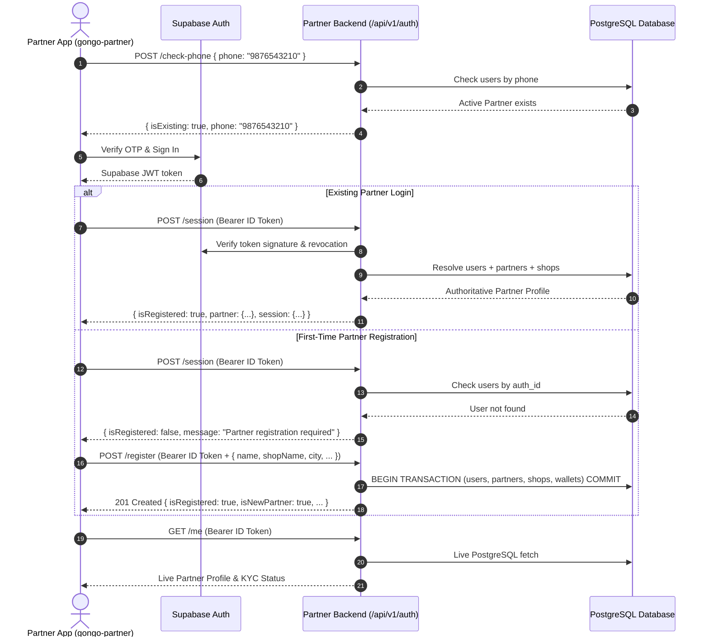

# GONGO Partner Backend — Authentication & Session API Specification

## 1. Overview
The **GONGO Partner Backend** utilizes a secure hybrid authentication architecture:
- **Authentication Authority**: Supabase Authentication verifies external credentials (e.g. Phone OTP verification) and issues cryptographically signed Supabase JWT tokens.
- **Identity & Authorization Authority**: PostgreSQL is the strict, authoritative source of application identity (`user.id`, `partner.id`), role (`role = 'PARTNER'`), operational status (`partner_status`), and compliance state (`kyc_status`).

> [!IMPORTANT]
> **Anti-Spoofing Guarantee**:
> Client-supplied `partnerId`, `userId`, `role`, `walletBalance`, `commission`, or `kyc_status` in headers, query parameters, or request bodies are **strictly rejected** by mass-assignment and BOLA controls.

---

## 2. Authentication Flow



---

## 3. Endpoints

### 3.1 Check Mobile Registration (`POST /api/v1/auth/check-phone`)
Checks whether a mobile number belongs to an active, registered Partner without exposing sensitive personal or financial information.

- **Access**: Public
- **Rate Limit**: 20 requests per 15 minutes per IP
- **Request Headers**:
  - `Content-Type: application/json`
- **Request Body**:
  ```json
  {
    "phone": "9876543210"
  }
  ```
- **Response (200 OK)**:
  ```json
  {
    "success": true,
    "data": {
      "isExisting": true,
      "phone": "9876543210"
    }
  }
  ```

---

### 3.2 Establish / Resolve Session (`POST /api/v1/auth/session`)
Exchanges a verified Supabase JWT token for an authoritative backend session and Partner profile.

- **Access**: Private (Bearer Supabase JWT token)
- **Rate Limit**: 30 requests per 15 minutes per IP
- **Request Headers**:
  - `Authorization: Bearer <SUPABASE_JWT_TOKEN>`
- **Response — Existing Registered Partner (200 OK)**:
  ```json
  {
    "success": true,
    "data": {
      "isRegistered": true,
      "user": {
        "id": "1d8b1390-50d4-4a27-a06a-ef96f13e7ce0",
        "name": "Vikram Sharma",
        "phone": "+91 9876543210",
        "email": "vikram@gongo.in",
        "role": "PARTNER",
        "isActive": true
      },
      "partner": {
        "id": "c1f71a07-8898-4c37-9759-3a3f5a05da82",
        "partnerStatus": "ONLINE",
        "kycStatus": "VERIFIED",
        "rating": 4.9,
        "reviewCount": 42,
        "registeredSince": "Nov 2024",
        "profileImage": "https://images.unsplash.com/photo-1507003211169-0a1dd7228f2d",
        "shopName": "Apex Wheels & Rentals",
        "shopAddress": "Plot 42, Commercial Zone, MP Nagar",
        "city": "Bhopal",
        "operatingInfo": "07:00 AM - 11:00 PM (All Days)",
        "bankAccount": null,
        "isNewPartner": false
      },
      "session": {
        "authenticated": true,
        "authProvider": "supabase"
      }
    }
  }
  ```
- **Response — Unregistered User (200 OK)**:
  ```json
  {
    "success": true,
    "data": {
      "isRegistered": false,
      "user": {
        "authId": "firebase_uid_12345",
        "phone": "+919123456780",
        "email": "new@gongo.in"
      },
      "message": "Partner registration required"
    }
  }
  ```

---

### 3.3 Register First-Time Partner (`POST /api/v1/auth/register`)
Executes an atomic registration transaction that creates the Partner's core records in PostgreSQL.

- **Access**: Private (Bearer Supabase JWT token)
- **Rate Limit**: 10 requests per 15 minutes per IP
- **Guarantees**:
  - Atomic database transaction across `users`, `partners`, `shops`, and `wallets`.
  - Initial `kyc_status` is strictly `PENDING`.
  - Initial `partner_status` is strictly `OFFLINE`.
  - Default `wallets` balance is initialized to `0.00` (`NUMERIC(12,2)`).
  - Server-owned fields (`role`, `status`, `walletBalance`, `commission`) are rejected with 400.
- **Request Headers**:
  - `Authorization: Bearer <SUPABASE_JWT_TOKEN>`
  - `Content-Type: application/json`
- **Request Body**:
  ```json
  {
    "name": "Ramesh Verma",
    "shopName": "Verma Wheels & Rentals",
    "city": "Bhopal",
    "shopAddress": "Plot 12, Main Road, Indrapuri",
    "phone": "9123456780",
    "email": "ramesh@gongo.in"
  }
  ```
- **Response (201 Created)**:
  ```json
  {
    "success": true,
    "data": {
      "isRegistered": true,
      "user": {
        "id": "e4f8d550-bdf1-4328-8d2a-40a2c918f0a1",
        "name": "Ramesh Verma",
        "phone": "+91 9123456780",
        "email": "ramesh@gongo.in",
        "role": "PARTNER",
        "isActive": true
      },
      "partner": {
        "id": "9b12d8a4-0ef6-43b9-a9a7-96a8fa00a12e",
        "partnerStatus": "OFFLINE",
        "kycStatus": "PENDING",
        "rating": 5.0,
        "reviewCount": 0,
        "registeredSince": "Sep 2026",
        "profileImage": null,
        "shopName": "Verma Wheels & Rentals",
        "shopAddress": "Plot 12, Main Road, Indrapuri",
        "city": "Bhopal",
        "operatingInfo": "08:00 AM - 10:00 PM (All Days)",
        "bankAccount": null,
        "isNewPartner": true
      },
      "session": {
        "authenticated": true,
        "authProvider": "supabase"
      }
    }
  }
  ```

---

### 3.4 Get Current Partner Profile (`GET /api/v1/auth/me`)
Returns the live, authoritative PostgreSQL profile of the authenticated Partner without relying on stale token claims.

- **Access**: Private (Bearer Supabase JWT token + `role = 'PARTNER'`)
- **Request Headers**:
  - `Authorization: Bearer <SUPABASE_JWT_TOKEN>`
- **Response (200 OK)**:
  ```json
  {
    "success": true,
    "data": {
      "user": {
        "id": "1d8b1390-50d4-4a27-a06a-ef96f13e7ce0",
        "name": "Vikram Sharma",
        "phone": "+91 9876543210",
        "email": "vikram@gongo.in",
        "role": "PARTNER",
        "isActive": true
      },
      "partner": {
        "id": "c1f71a07-8898-4c37-9759-3a3f5a05da82",
        "partnerStatus": "ONLINE",
        "kycStatus": "VERIFIED",
        "rating": 4.9,
        "reviewCount": 42,
        "registeredSince": "Nov 2024",
        "profileImage": "https://images.unsplash.com/photo-1507003211169-0a1dd7228f2d",
        "shopName": "Apex Wheels & Rentals",
        "shopAddress": "Plot 42, Commercial Zone, MP Nagar",
        "city": "Bhopal",
        "operatingInfo": "07:00 AM - 11:00 PM (All Days)",
        "bankAccount": null
      }
    }
  }
  ```

---

### 3.5 Server-Side Logout (`POST /api/v1/auth/logout`)
Revokes Supabase tokens/sessions and records an audit event.

- **Access**: Private (Bearer Supabase JWT token)
- **Request Headers**:
  - `Authorization: Bearer <SUPABASE_JWT_TOKEN>`
- **Response (200 OK)**:
  ```json
  {
    "success": true,
    "data": {
      "message": "Logged out successfully"
    }
  }
  ```

---

## 4. Error Code Reference

| Status Code | Error Code | Description |
|---|---|---|
| `400` | `VALIDATION_ERROR` | Malformed input or missing required registration fields |
| `400` | `MASS_ASSIGNMENT_VIOLATION` | Request contains server-controlled fields (`role`, `status`, `kycStatus`, etc.) |
| `401` | `AUTH_REQUIRED` | Missing `Authorization` header |
| `401` | `INVALID_TOKEN` | Token is invalid, malformed, or unverified by Supabase |
| `401` | `TOKEN_EXPIRED` | Supabase JWT token has expired |
| `401` | `TOKEN_REVOKED` | Supabase JWT token has been revoked |
| `403` | `FORBIDDEN` | Access forbidden: user role is not `PARTNER` (e.g. `CUSTOMER`) |
| `403` | `ACCOUNT_DEACTIVATED` | Partner account is deactivated or suspended |
| `404` | `NOT_FOUND` | Partner profile not found in database |
| `409` | `CONFLICT` | Account already registered for this authentication identity |
| `409` | `DUPLICATE_RESOURCE` | Mobile number already registered to another user |
| `429` | `RATE_LIMIT_EXCEEDED` | Rate limit threshold exceeded |
